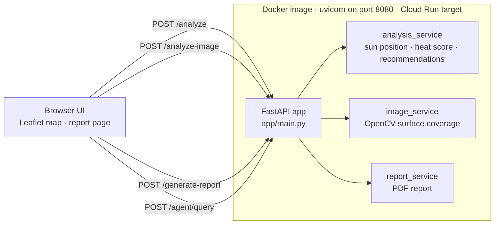
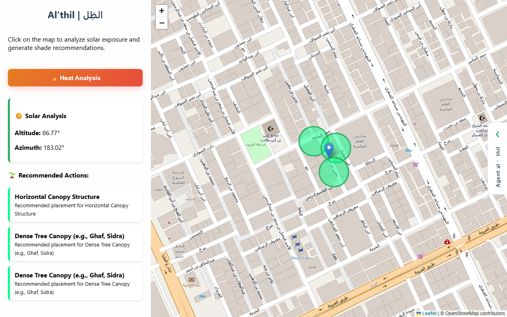
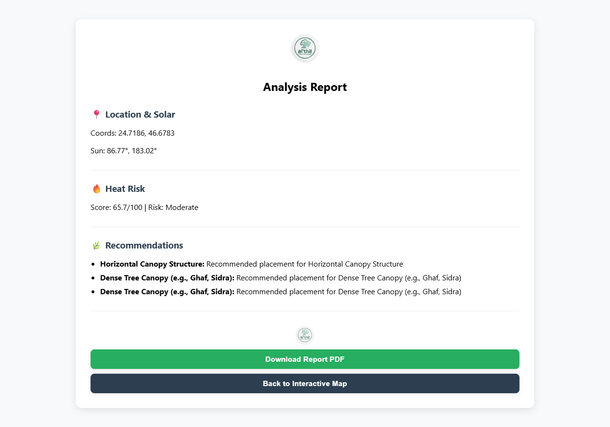

<picture>
  <source media="(max-width: 600px)" srcset="assets/branding/hero-mobile.svg">
  
</picture>

# Althil

A map-based decision-support prototype that helps urban planners decide where shade interventions belong, from sun position, a heat-exposure score and site-image analysis.

**Status: hackathon prototype.** Built by a team at the KFUPM × Google Cloud Intelligent Planet Hackathon. It runs locally and as a container, it has not been used by a city, and no cooling effect has been measured. Several inputs are simulated or estimated; [Trust and honesty about the numbers](#trust-and-honesty-about-the-numbers) lists each one.

## Overview

Heat exposure in a city street depends on where the sun is, what the ground is made of and how much shade already exists. Planners who want to add canopies, shade sails or trees need a quick way to see which spots are most exposed and which kind of shade suits the sun angle there.

Althil turns that into one interaction: click a point on the map, and the backend returns the sun's position, a heat-risk score, a recommended shade type with candidate placements, and a downloadable report. A site photo can be added to estimate how much of the surface is vegetation versus hard, grey surface.

## Why Althil

Shade infrastructure is expensive and permanent, so the question is less *whether* to add shade than *where first* and *what kind*. A canopy that works under a high noon sun is the wrong answer for a low western sun; a street that is already green needs less than an open asphalt plaza. Althil keeps those inputs — sun geometry, surface type and a heat score — next to each other on a map, and explains the recommendation it makes.

## What it does

1. **Locate.** A Leaflet map (OpenStreetMap tiles, centred on Riyadh) captures the clicked latitude and longitude.
2. **Read the sun.** `POST /analyze` computes the sun's altitude and azimuth for that point at the current UTC time with `pysolar`.
3. **Score the heat.** A rule combines sun altitude with an urban-density factor into a 0–100 heat score and a Low / Moderate / High risk level.
4. **Recommend shade.** The sun angle selects the shade type — horizontal canopy above 60°, angled shade sail above 30°, vertical green wall below — and three candidate points are placed around the selected location.
5. **Read the site.** `POST /analyze-image` measures vegetation and grey-surface coverage in an uploaded photo with OpenCV colour thresholds and maps it to a shade need.
6. **Report.** A report page summarises the analysis, and `POST /generate-report` returns it as a PDF.

## Architecture



One FastAPI process serves the UI, the static assets and every analysis endpoint, so the whole system ships as a single container.

| Component | Responsibility |
|---|---|
| `app/main.py` | FastAPI app, request models, CORS, page routes and the API endpoints |
| `app/services/analysis_service.py` | Sun position (`pysolar`), heat score, simulated urban density, shade recommendations |
| `app/services/image_service.py` | Vegetation and grey-surface coverage from an uploaded photo (OpenCV, HSV thresholds) |
| `app/services/report_service.py` | PDF report generation (`fpdf`) |
| `app/templates/`, `app/static/` | Map page, report page, styles and browser logic |
| `Dockerfile` | Python 3.10 slim image running uvicorn on port 8080, the Cloud Run default |
| `legacy/` | The team's first standalone prototype, kept for reference |

| Endpoint | Purpose |
|---|---|
| `GET /` | Interactive map |
| `GET /report` | Report page for the last analysis |
| `POST /analyze` | `{lat, lng}` → sun data, heat analysis, recommendations |
| `POST /analyze-image` | Multipart image → surface coverage and shade need |
| `POST /generate-report` | Analysis JSON → PDF |
| `POST /agent/query` | Scripted assistant reply for the selected point |

FastAPI's interactive API documentation is available at `/docs` while the app is running.

## Technology stack

| Area | Technologies |
|---|---|
| Backend | Python, FastAPI, Pydantic, uvicorn |
| Analysis | pysolar (solar position), OpenCV and NumPy (image analysis), rule-based scoring |
| Reporting | fpdf |
| Frontend | HTML, CSS, JavaScript, Leaflet, Leaflet.heat, OpenStreetMap tiles |
| Packaging | Docker, targeting Google Cloud Run |
| Testing | pytest, FastAPI TestClient |

## Google Cloud architecture

The verified Google Cloud piece in this repository is **Cloud Run packaging**: the `Dockerfile` builds a slim Python image, installs OpenCV's system libraries and serves the app with uvicorn on port 8080, the port Cloud Run sends traffic to by default. The app is stateless — analysis results live in the browser's `localStorage` — so a single Cloud Run service can run it without a database.

The hackathon design also called for **BigQuery** (analysis history), **Cloud Storage** (uploaded site images and reports) and **Vertex AI** (model-based analysis). **None of these is implemented in this repository**, and no deployment configuration, project ID or service URL from the event is committed. They are listed as next steps, not as features.

## Key features

- Solar altitude and azimuth for any clicked point, computed with `pysolar`
- 0–100 heat score with Low / Moderate / High risk levels
- Shade type chosen from the sun angle, with native tree suggestions (Ghaf, Sidra)
- Three candidate placements drawn on the map around the selected point
- Vegetation and grey-surface coverage from an uploaded site photo
- Report page and downloadable PDF with an explicit "estimated values" disclaimer
- Single-container deployment unit aimed at Cloud Run
- Automated tests for every service and endpoint

## Trust and honesty about the numbers

- **Urban density is simulated.** `simulate_urban_density` derives a repeatable 20–80 value from the coordinates; it is not measured from land-use or satellite data.
- **The heat score is a rule, not a temperature.** It weights sun altitude (60%) and the simulated density factor (40%); it is not calibrated against measured temperatures.
- **Placements are illustrative.** The three candidate points are random offsets of up to about 55 m around the click, not an optimised siting.
- **Cooling figures are placeholders.** `estimated_temp_reduction` (3–8 °C) and the tree count are random values within a range and are labelled "Estimated".
- **Image analysis is colour thresholding.** Green and grey pixel ratios stand in for vegetation and hard surfaces; there is no trained segmentation model.
- **The heat overlay is simulated.** The "Heat Analysis" map layer draws random hotspots around the map centre in the browser, labelled "Estimated".
- **The assistant is scripted.** *Agent al'thil* returns a templated reply and a 150 m highlight for the selected point; no language model is connected.
- **Time is always "now".** Sun position uses the current UTC time, so at night the altitude is negative and the rules still return a recommendation.

## Screenshots





Captured from the running app at 1280 × 800. Because the app always uses the current time, the server clock was pinned to 15 July 2026, 12:00 Riyadh time (UTC+3) for these captures so the sun is above the horizon; nothing else was changed.

## My contribution

Althil was a team project; this is my part of it, not the whole.

- **Backend development** — the FastAPI application and its analysis endpoints
- **Integration** — bringing the sun-position, heat-scoring, image-analysis and report services together into one deployable application
- **Cloud architecture** — packaging that application as a single container for Cloud Run, and the Google Cloud direction of the design

After the hackathon I prepared this public repository: bug fixes, tests, documentation and the branding assets were added in that pass and are visible in the commit history.

## Getting started

Requirements: Python 3.10–3.12 (the container uses 3.10) and Git. Docker is optional.

```bash
git clone https://github.com/Abdulel3h/Althil.git
cd Althil
python -m venv .venv
. .venv/Scripts/activate    # Windows (Git Bash); on macOS/Linux: . .venv/bin/activate
pip install -r requirements.txt
```

## Environment variables

| Name | Required | Purpose |
|---|---|---|
| `ALLOWED_ORIGINS` | No | Comma-separated origins allowed to call the API from another host. Defaults to `localhost` / `127.0.0.1` on ports 8000 and 5500. The bundled UI is same-origin and needs no entry. |

The app needs no API keys or cloud credentials. [`.env.example`](.env.example) lists the variable; the app does not load `.env` files itself, so export the variable or pass the file to Docker with `--env-file`.

## Running locally

```bash
uvicorn app.main:app --reload
```

Open `http://127.0.0.1:8000`, click anywhere on the map, then use **View Report** for the report page and PDF.

Call the API directly:

```bash
curl -X POST http://127.0.0.1:8000/analyze \
  -H "Content-Type: application/json" \
  -d "{\"lat\": 24.7136, \"lng\": 46.6753}"
```

Run the tests:

```bash
pip install -r requirements-dev.txt
python -m pytest
```

## Deployment

Build and run the same image Cloud Run would run:

```bash
docker build -t althil .
docker run --rm -p 8080:8080 althil
```

Then open `http://localhost:8080`. To deploy it to Cloud Run from source, with your own project and region:

```bash
gcloud run deploy althil --source . --region <region> --allow-unauthenticated
```

The hackathon deployment itself is not preserved in this repository, so the command above is the standard path for this `Dockerfile`, not a record of the event's setup.

## Limitations

- **Simulated and estimated inputs** — see [Trust and honesty about the numbers](#trust-and-honesty-about-the-numbers).
- **Point analysis only.** There is no area-wide ranking of candidate sites and no shadow casting from buildings.
- **No persistence.** Results live in the browser; nothing is stored server-side.
- **Desktop layout.** The map interface is built for desktop screens.
- **Not validated.** Recommendations have not been reviewed by planners or compared with field temperature data.

## Next steps

- Replace simulated density with land-cover or satellite data, for example through BigQuery public datasets
- Let the user choose the date and time, and handle the sun below the horizon
- Rank candidate sites across an area instead of offsetting around one point
- Store uploads and reports in Cloud Storage and analysis history in BigQuery
- Validate scores against measured street temperatures

## Hackathon

Built at the **KFUPM × Google Cloud Intelligent Planet Hackathon**, a cloud and AI hackathon on environmental and urban challenges hosted by King Fahd University of Petroleum and Minerals with Google Cloud. The team's original commits (January 2026) are preserved at the start of the history.

## Repository structure

```text
app/
  main.py               FastAPI app and endpoints
  services/             Sun, heat, recommendation, image and report services
  templates/            Map and report pages
  static/               Styles, browser logic, logo
tests/                  Service and API tests
legacy/                 First standalone prototype (backend/ + frontend/), kept for reference
docs/                   Architecture, case study, decisions, reviewer guide
assets/branding/        Generated README and social artwork
assets/screenshots/     Captures from the running app
tools/                  Branding asset generator
Dockerfile              Cloud Run-ready container
```

## Documentation

[Architecture](docs/architecture.md) · [Case study](docs/case-study.md) · [Engineering principles](docs/engineering-principles.md) · [Technical decisions](docs/technical-decisions.md) · [Reviewer guide](docs/reviewer-guide.md) · [Branding assets](assets/branding/README.md) · [Case study on abdulelah.de](https://www.abdulelah.de/projects/althil)

## License

No license file is currently present. All rights are reserved by default unless a license is added.

## Contact

**Abdulelah Alkhathami** · [Portfolio](https://abdulelah.de) · [GitHub](https://github.com/Abdulel3h) · [Email](mailto:me@abdulelah.de)
