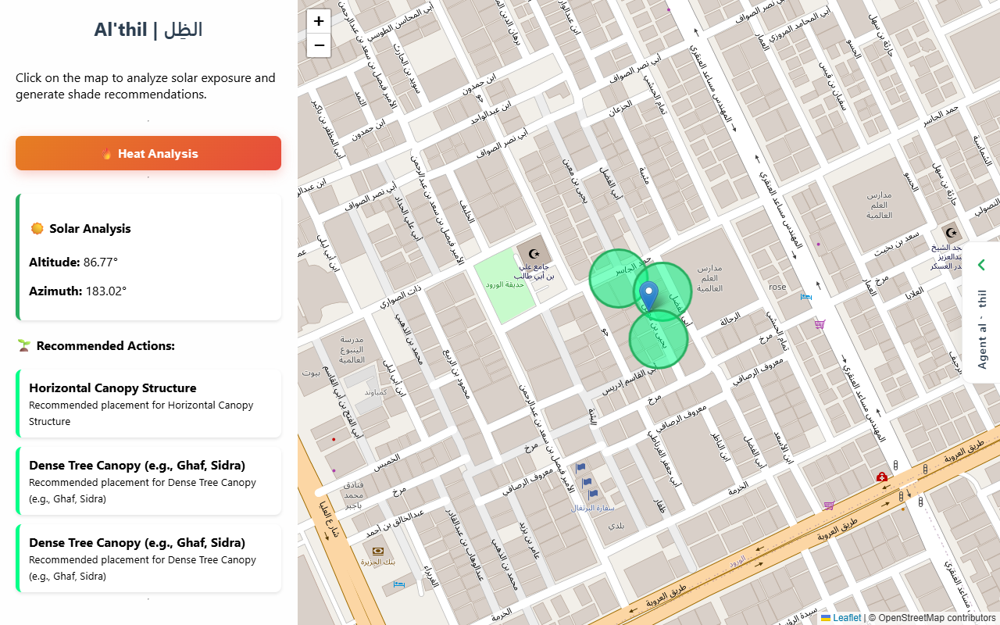
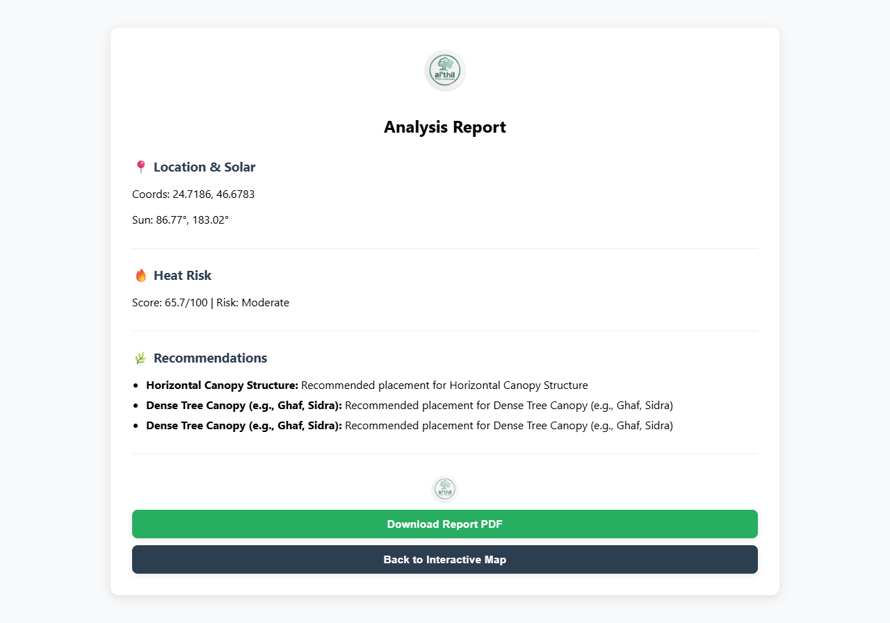

<a href="https://github.com/Abdulel3h">
  <picture>
    <source media="(max-width: 600px)" srcset="assets/terminal-mobile.svg">
    
  </picture>
</a>

**A map-based decision-support prototype that suggests where shade belongs, from sun position, a heat score and site-image analysis.**

Team prototype from the KFUPM × Google Cloud Intelligent Planet Hackathon. My part was the backend, the service integration and the Cloud Run packaging. It runs locally and as a container; it has not been used by a city, no cooling effect has been measured, and several inputs are simulated.

###### HOW IT WORKS

1. **Pick a point.** A Leaflet map, centred on Riyadh, sends the clicked latitude and longitude to `POST /analyze`.
2. **Read the sun.** `pysolar` computes the sun's altitude and azimuth for that point at the current UTC time.
3. **Score the heat.** A rule weights sun altitude (60%) and a simulated urban density (40%) into a 0–100 score.
4. **Choose the shade.** Above 60° a horizontal canopy, above 30° an angled shade sail, lower a vertical green wall.
5. **Read the site and report.** An optional photo is measured for vegetation and grey surface with OpenCV, and the analysis exports as a PDF.

###### EVIDENCE

- The hero's numbers come from running the repository's own code with `pysolar` for Riyadh at 12:00 on 15 July 2026, the time the screenshots were captured.
- Automated `pytest` tests cover every service and endpoint.
- One stateless container serves the UI and API with uvicorn on port 8080, the Cloud Run default.

**Simulated or estimated:** urban density, the heat overlay, the candidate placements (random offsets of up to about 55 m), the cooling figures and the scripted assistant. The heat score is a rule, not a temperature. BigQuery, Cloud Storage and Vertex AI were part of the hackathon design and are not implemented here. [Every number, explained](docs/overview.md#trust-and-honesty-about-the-numbers)

<details>
<summary>Screenshots</summary>





Captured from the running app at 1280 × 800 with the server clock pinned to 15 July 2026, 12:00 Riyadh time, so the sun is above the horizon.
</details>

###### QUICK START

Python 3.10–3.12 (the container uses 3.10). The app needs no API keys or cloud credentials.

```bash
git clone https://github.com/Abdulel3h/Althil.git
cd Althil
python -m venv .venv
. .venv/Scripts/activate           # macOS/Linux: . .venv/bin/activate
pip install -r requirements.txt
uvicorn app.main:app --reload
```

Open `http://127.0.0.1:8000` and click the map, or call the API:

```bash
curl -X POST http://127.0.0.1:8000/analyze \
  -H "Content-Type: application/json" \
  -d "{\"lat\": 24.7136, \"lng\": 46.6753}"
```

Tests and the Cloud Run image:

```bash
pip install -r requirements-dev.txt && python -m pytest
docker build -t althil . && docker run --rm -p 8080:8080 althil
```

[Environment variables and deployment](docs/overview.md#environment-variables)

###### DOCUMENTATION

[Overview](docs/overview.md) · [Architecture](docs/architecture.md) · [Case study](docs/case-study.md) · [Engineering principles](docs/engineering-principles.md) · [Technical decisions](docs/technical-decisions.md) · [Reviewer guide](docs/reviewer-guide.md) · [Case study on abdulelah.de](https://www.abdulelah.de/projects/althil)

<sub>[Abdulelah Alkhathami](https://github.com/Abdulel3h) · [abdulelah.de](https://www.abdulelah.de) · Built by a team at the KFUPM × Google Cloud Intelligent Planet Hackathon; the team's original commits open the history. No license file yet, so all rights are reserved by default.</sub>
