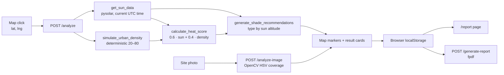

# Althil Architecture

Althil is a single FastAPI application that serves its own map interface and exposes every analysis as an HTTP endpoint. Everything ships in one container aimed at Google Cloud Run.

## System flow

## Request lifecycle

1. The browser posts `{lat, lng}` to `/analyze`.
2. `get_sun_data` computes altitude and azimuth with `pysolar` for the current UTC time.
3. `simulate_urban_density` seeds a pseudo-random generator from the coordinates and returns a repeatable 20–80 density.
4. `calculate_heat_score` clamps `1.1 × altitude` to 0–100, weights it 60%, adds 40% of half the density, and assigns a risk level (> 70 High, > 40 Moderate).
5. `generate_shade_recommendations` picks the shade type from the sun altitude, the cooling potential from the heat score, and places three candidate points within ±0.0005° of the click.
6. The browser renders cards and map circles and stores the response in `localStorage` for the report page.

## Image analysis

`analyze_urban_image` decodes the upload with OpenCV, converts it to HSV and counts:

| Class | HSV range | Meaning |
|---|---|---|
| Vegetation | H 35–85, S ≥ 40, V ≥ 40 | Green cover |
| Grey surface | S ≤ 50, V 50–200 | Asphalt, concrete, hard ground |

More than 50% grey surface is **Critical**, more than 30% is **High**, more than 40% vegetation is **Low**, anything else is **Moderate**. Undecodable files return `{"error": "Could not decode image"}`.

## Deployment unit

- `Dockerfile`: `python:3.10-slim`, OpenCV system libraries (`libgl1`, `libglib2.0-0`), pinned `requirements.txt`, uvicorn on port 8080.
- `.dockerignore` keeps the image to the runtime: no `legacy/`, tests, docs or artwork.
- The service is stateless, so it scales horizontally without coordination.

## Designed but not implemented here

The hackathon design placed analysis history in BigQuery, uploads and reports in Cloud Storage, and model-based analysis on Vertex AI. None of these integrations exists in this codebase.

## Production gaps

- Real land-cover data in place of simulated density
- User-selected date and time, and night-time handling
- Area-wide site ranking and building shadow casting
- Server-side persistence and authentication before any shared deployment
- Calibration of the heat score against measured temperatures
